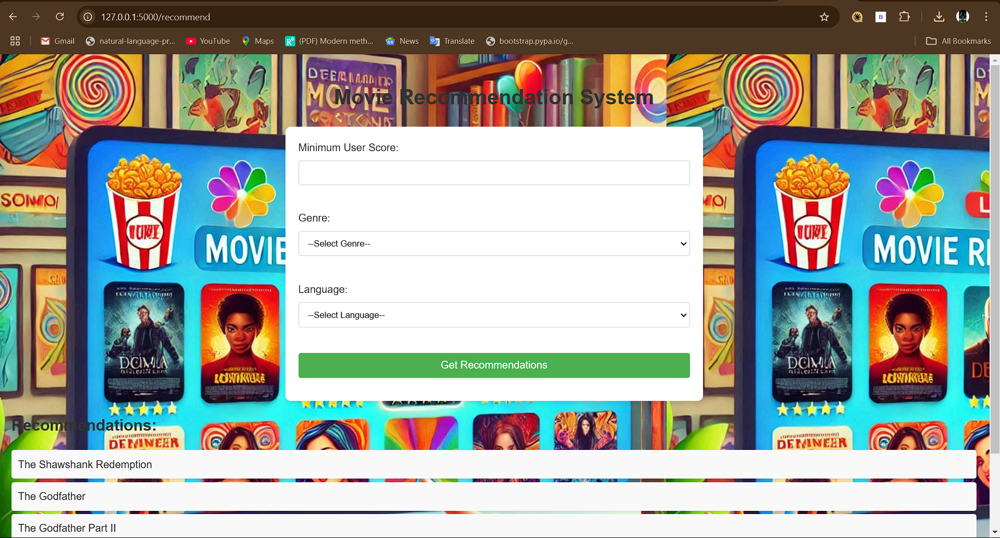
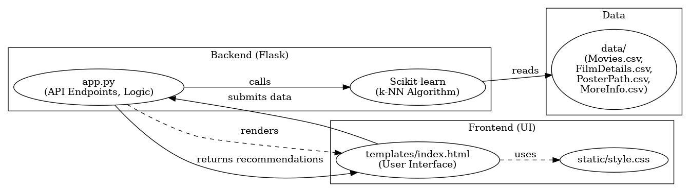

# 🎬 Movie Recommendation System

> An end-to-end Machine Learning movie recommendation platform combining **Content-Based k-Nearest Neighbors (k-NN) with Cosine Similarity** on TF-IDF metadata and **Multi-Criteria Feature Filtering** across a curated catalog of **9,718 films**.

[](https://www.python.org/)
[](https://flask.palletsprojects.com/)
[](https://streamlit.io/)
[](https://scikit-learn.org/)
[]()
[](LICENSE)

---

## 🎥 Demo & Deployment

- **Flask Application:** Full-featured server-rendered web portal and REST API running at `http://127.0.0.1:5000/`.
- **Streamlit Exploration Dashboard:** Interactive data science dashboard running via `streamlit run streamlit_app.py`.
- **Custom Domain Note:** The repository includes a `CNAME` configuration (`movierecommendations.io`) configured for GitHub Pages custom domain mapping.

---

## 🖥️ Screenshots

| Recommendation Web Portal | Architecture Workflow |
|:---:|:---:|
|  |  |

---

## 🎯 Overview

Finding relevant films across expansive movie catalogs requires effective similarity modeling and flexible preference filtering. This project delivers a machine learning solution that:

1. **Calculates Content Similarity:** Uses high-dimensional TF-IDF vectorization across movie genres, directors, cast members, and languages, normalized alongside user ratings and popularity signals.
2. **Nearest Neighbor Matching:** Employs an unsupervised **k-Nearest Neighbors (k-NN)** model with a **Cosine Distance** metric to find the most contextually relevant films for any queried title.
3. **Multi-Criteria Demographic Filtering:** Allows users to filter and rank films by genre, language, and minimum rating thresholds.
4. **Visual & Metadata Richness:** Pairs recommendations with high-resolution TMDb poster artwork, release metadata, cast credits, and match percentages.

---

## ✨ Key Features

- 🎯 **Content-Based Movie Similarity:** Query any film (e.g., *The Godfather*, *Inception*, *Spirited Away*) to retrieve top-$k$ nearest neighbors ranked by cosine similarity.
- 🎛️ **Multi-Criteria Ranking:** Filter catalog films by minimum user score (0.0–10.0), specific genres (19 categories), and original languages (45 language codes).
- 🖼️ **TMDb Poster Integration:** Seamlessly merged poster artwork and backdrops for all 9,718 catalog entries.
- 🌐 **Dual Frontend Interfaces:**
  - **Flask Web Application:** Server-rendered UI with dark-mode aesthetic, autocomplete search, and instant recommendation results.
  - **Streamlit Interactive Dashboard:** Exploratory data science dashboard for real-time model tuning and catalog exploration.
- ⚡ **RESTful JSON API:** Programmatic access via `/api/recommend`, `/api/movies`, and `/api/metadata`.
- 🧪 **100% Offline Test Suite:** 16 automated tests covering ML recommender correctness, filter boundary conditions, and API endpoints.

---

## 🧠 Recommendation Pipeline

The recommendation engine implements a hybrid content representation combining sparse textual metadata with scaled numerical features:

```text
┌────────────────────────────────────────────────────────┐
│               Curated Movie Catalog (9,718)            │
│  [title, genres, director, top_billed, language, score]│
└───────────────────────────┬────────────────────────────┘
                            │
        ┌───────────────────┴───────────────────┐
        ▼                                       ▼
 ┌───────────────────────────┐   ┌───────────────────────────┐
 │ Text Metadata Aggregation │   │ Numerical Signal Scaling  │
 │ (Genre, Dir, Cast, Lang)  │   │ (User Score, log(Votes))  │
 └─────────────┬─────────────┘   └─────────────┬─────────────┘
               ▼                               ▼
 ┌───────────────────────────┐   ┌───────────────────────────┐
 │     TF-IDF Vectorizer     │   │      Min-Max Scaler       │
 │   (5,000 max features)    │   │      [0.0, 1.0] Range     │
 └─────────────┬─────────────┘   └─────────────┬─────────────┘
               │ (Weight: 85%)                 │ (Weight: 15%)
               └───────────────┬───────────────┘
                               ▼
            ┌────────────────────────────────────┐
            │   Combined Feature Matrix (F)      │
            └──────────────────┬─────────────────┘
                               ▼
            ┌────────────────────────────────────┐
            │ NearestNeighbors(metric='cosine')  │
            └──────────────────┬─────────────────┘
                               ▼
            ┌────────────────────────────────────┐
            │  Query Film Index & k-NN Search    │
            │  Cosine Distance: d(u,v) = 1 - cos │
            └──────────────────┬─────────────────┘
                               ▼
            ┌────────────────────────────────────┐
            │ Top-N Nearest Movies + Similarity %│
            └────────────────────────────────────┘
```

### Mathematical Formulation

1. **Textual Feature Space:**
   $$\text{TF-IDF}(t, d, D) = \text{TF}(t, d) \times \log\left(\frac{1 + |D|}{1 + |\{d \in D : t \in d\}|}\right) + 1$$
2. **Feature Fusion:**
   $$X = \Big[\, 0.85 \cdot X_{\text{TF-IDF}} \quad\big\|\quad 0.15 \cdot X_{\text{scaled}} \,\Big]$$
3. **Cosine Distance Metric:**
   $$d(\mathbf{u}, \mathbf{v}) = 1 - \frac{\mathbf{u} \cdot \mathbf{v}}{\|\mathbf{u}\|_2 \|\mathbf{v}\|_2}$$
4. **Similarity Score:**
   $$\text{Similarity}(\mathbf{u}, \mathbf{v}) = 1.0 - d(\mathbf{u}, \mathbf{v})$$

---

## 📊 Dataset Architecture & Verified Statistics

The repository contains verified datasets without external runtime download dependencies:

| Dataset File | Rows | Columns | Description |
|:---|:---:|:---:|:---|
| **`merged_movie_data.csv`** | **9,718** | **13** | Core movie catalog containing title, genres, language, score, runtime, release date, director, cast, budget, and revenue. |
| **`PosterPath.csv`** | **9,718** | **3** | Direct TMDb CDN URLs (`poster_path`, `backdrop_path`) linked by unique movie ID. (0 missing entries). |
| **`FilmDetails.csv`** | **9,718** | **5** | Extended film production metadata (director, cast, budget, revenue). |
| **`Movie Ratings.csv`** | **227,472** | **4** | Historical interaction records across 26,770 unique users and 15,742 movies. |

### Catalog Distribution
- **Total Unique Films:** 9,718
- **Unique Genre Categories:** 19 (`Drama`, `Comedy`, `Action`, `Thriller`, `Crime`, `Romance`, `Sci-Fi`, `Animation`, etc.)
- **Unique Languages:** 45 (Top: English `7,695`, French `630`, Italian `349`, Japanese `271`, Spanish `179`, German `90`, Korean `84`)
- **User Score Range:** 2.2 – 8.7 (Mean: 6.63, Median: 6.70)

---

## 🏗️ Project Structure

```text
Movie_recommendations/
├── app.py                      # Primary Flask application (UI & REST API)
├── streamlit_app.py            # Streamlit interactive exploration dashboard
├── recommender.py              # Convenience root import alias
├── requirements.txt            # Python dependencies
├── .env.example                # Sample environment configuration
├── .gitignore                  # Security & cache exclusion rules
├── CNAME                       # Custom domain mapping
│
├── src/                        # Core ML Recommendation Engine
│   ├── __init__.py
│   └── recommender.py          # MovieRecommender class (k-NN & filtering)
│
├── static/                     # Web assets & stylesheets
│   ├── Designer.jpeg           # Background asset
│   └── style.css               # Modern dark-theme stylesheet
│
├── templates/                  # Server-rendered templates
│   └── index.html              # Responsive recommendation portal
│
├── screenshots/                # Application documentation visuals
│   ├── architecture_diagram.png
│   ├── code_screenshot.png
│   └── output_preview.png
│
├── tests/                      # Automated test suite
│   ├── __init__.py
│   ├── test_recommender.py     # ML engine unit tests
│   └── test_app.py             # Flask integration tests
│
└── data/ (Curated CSVs)
    ├── merged_movie_data.csv
    ├── PosterPath.csv
    ├── FilmDetails.csv
    └── Movie Ratings.csv
```

---

## ⚙️ Installation & Usage Guide

### Prerequisites
- Python 3.9+ (tested on Python 3.10 and 3.11)
- pip / virtualenv

### 1. Clone the Repository
```bash
git clone https://github.com/Kondareddy1209/Movie_recommendations.git
cd Movie_recommendations
```

### 2. Create Virtual Environment & Install Dependencies
```bash
python -m venv venv
# On Windows:
venv\Scripts\activate
# On Linux/macOS:
source venv/bin/activate

pip install -r requirements.txt
```

### 3. Run Flask Application (Primary App)
```bash
python app.py
```
Open your browser at **`http://127.0.0.1:5000`**.

### 4. Run Streamlit Application (Interactive Dashboard)
```bash
streamlit run streamlit_app.py
```
Open your browser at **`http://localhost:8501`**.

---

## 🔌 REST API Documentation

The Flask application exposes JSON endpoints for headless consumption:

### 1. Content-Based Similarity Recommendations
```http
GET /api/recommend?title=The+Godfather&limit=5
```
**Response (200 OK):**
```json
{
  "status": "success",
  "type": "content_similarity",
  "count": 5,
  "target_movie": {
    "title": "The Godfather",
    "user_score": 8.7,
    "genres": "Drama, Crime",
    "director": "Francis Ford Coppola"
  },
  "recommendations": [
    {
      "title": "The Godfather Part II",
      "user_score": 8.6,
      "similarity_score": 0.5682,
      "poster_path": "https://image.tmdb.org/t/p/w500/..."
    }
  ]
}
```

### 2. Multi-Criteria Preference Filter
```http
GET /api/recommend?genre=Drama&language=en&min_score=8.5&limit=5
```

### 3. Autocomplete / Search Movies
```http
GET /api/movies?q=Inception
```

### 4. Metadata Summary
```http
GET /api/metadata
```

---

## 🧪 Testing & Quality Assurance

The test suite runs completely offline without requiring API keys or external services:

```bash
pytest -v
```

### Test Coverage Summary:
- **ML Recommender Unit Tests (`test_recommender.py`):**
  - Dataset schema integrity and 9,718 movie verification
  - k-NN similarity correctness and self-exclusion validation
  - Similarity score range $[0.0, 1.0]$ bounds
  - Non-existent title and boundary condition handling
  - Genre & language preference filtering
  - Autocomplete title search
- **Flask Integration Tests (`test_app.py`):**
  - `GET /` home view rendering
  - `POST /recommend` similarity search & filter submissions
  - `GET /api/recommend` JSON endpoints
  - `GET /api/movies` search endpoint
  - `GET /api/metadata` endpoint

---

## ⚖️ License

Distributed under the **MIT License**. See `LICENSE` for more information.
